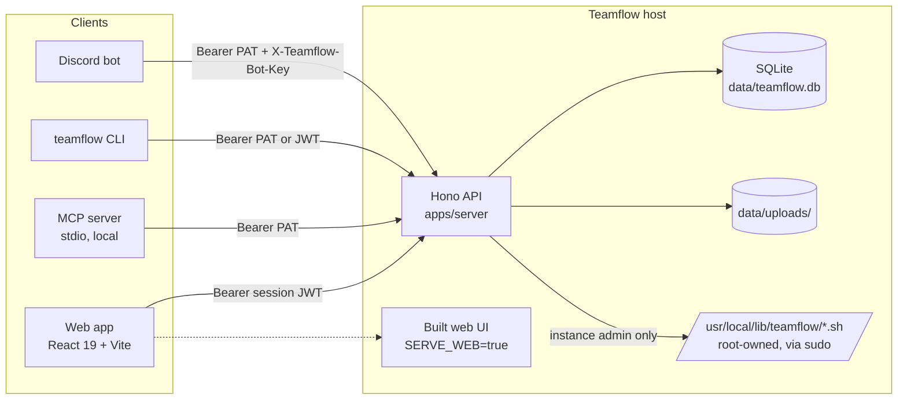
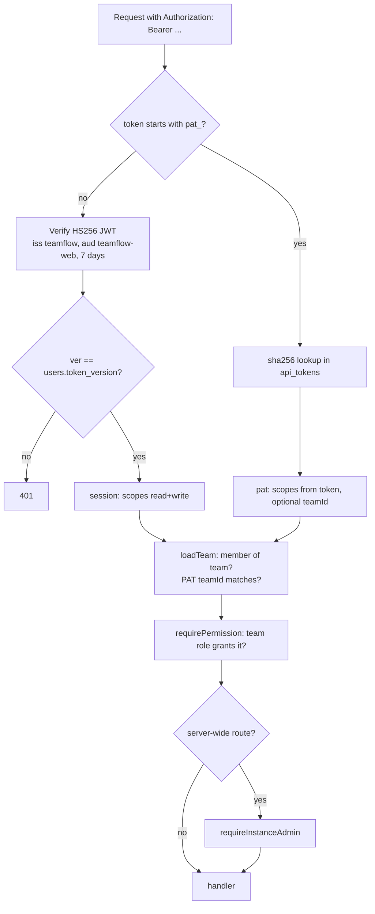
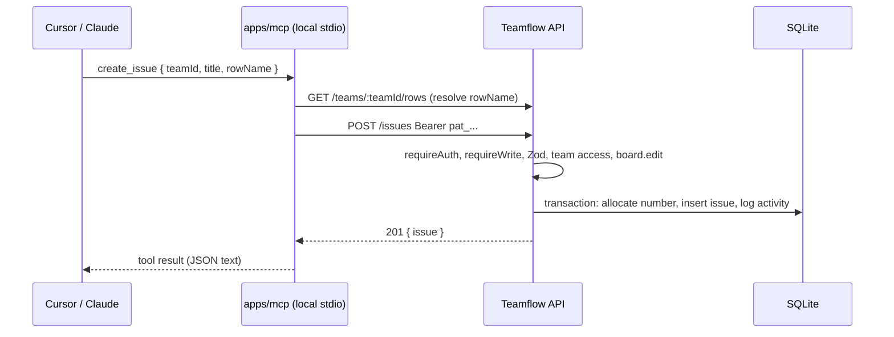
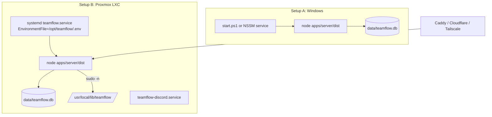

# Architecture

How Teamflow is put together. Route-level detail lives in [API.md](API.md) (generated from the route files); permissions and tokens in [AUTH.md](AUTH.md).

## System



One Node 20 process serves the API and, in production, the built web UI on the same port (default 3000). The database is SQLite through `better-sqlite3` and Drizzle. **Postgres is not supported**: an earlier version of these docs claimed it, and the LXC installer still installs a Postgres package, but nothing uses it. Postgres support is deferred.

## Monorepo map

pnpm workspace, Node 20 (`.nvmrc`, `engines`), TypeScript everywhere.

| Path | Responsibility | Depends on |
|------|----------------|------------|
| `packages/core` | Types, Zod schemas, permissions and role templates, priorities, refs, shared constants | — |
| `packages/db` | Drizzle schema, `init.sql`, versioned schema patches, demo seed, data maintenance | core |
| `packages/api-client` | `TeamflowClient`: typed fetch wrapper for every route, `withSignal()` for abort | core |
| `apps/server` | Hono HTTP API, auth, file storage, maintenance hooks, serves the web build | core, db |
| `apps/web` | React UI (react-router, TanStack Query) | core, api-client |
| `apps/mcp` | MCP tool definitions over stdio | core, api-client |
| `apps/cli` | `teamflow` command (commander) | api-client |
| `apps/discord-bot` | discord.js bot: slash commands, ticket threads | core, api-client |
| `deploy/` | Windows (A), Proxmox LXC (B), relay notes, optional Docker | — |
| `scripts/gen-api-docs.mjs` | Generates [API.md](API.md) from `apps/server/src/routes` | — |

**Rule:** only `apps/server` imports `packages/db`. MCP, CLI, bot and web reach data through the HTTP API.

Workspace packages resolve through their `dist/`, so build them (`pnpm build`) before running the apps or `pnpm typecheck`. Tests do not need a build: `vitest.config.ts` aliases `@teamflow/*` to the sources.

## Server (`apps/server/src`)

```text
index.ts        boot: purge expired uploads and trashed team files, listen, optional nightly maintenance
app.ts          createApp(): request id, error handler, global middleware, mounts every routes/* sub-app, SPA fallback
config.ts       one Zod schema for every env var, read once at boot; refuses placeholder secrets
db.ts           the shared Drizzle handle
middleware/
  auth.ts       requireAuth, optionalAuth, requireWrite, requireInstanceAdmin
  team.ts       loadTeam(source) resolves the team from :teamId / row / issue / status / upload / attachment,
                canAccessTeam (membership + PAT team scope), requirePermission(perm)
  params.ts     validateParams: every :id path param must be a UUID
  http.ts       CORS allowlist, X-Content-Type-Options: nosniff, body size caps, auth rate limit
  error.ts      handleError: ApiError → { error, code }; anything else → 500 internal_error
routes/         one Hono sub-app per area (auth, tokens, teams, board, members, invites, roles,
                discord, maintenance, files, projects, issues, comments, attachments, uploads, health, spa)
lib/            domain helpers (issues, board, attachments, chunkedUpload, teamBundle, roles, invites,
                passwordReset, mail, secretsCrypto, hostScripts, maintenance, discordBotService, ...)
lib/errors.ts   ApiError(status, message, code) and helpers (badRequest, forbidden, notFound, conflict, ...)
lib/validation.ts parseBody / parseQuery with the Zod schemas from core; malformed JSON is 400
```

A typical mutating route reads as a middleware chain:

```ts
routes.patch("/rows/:rowId", requireAuth, requireWrite, validateParams,
  loadTeam("row"), requirePermission("board.edit"), async (c) => { ... });
```

Conventions:

- **Errors.** Throw `ApiError` (or a helper from `lib/errors.ts`); the body is always `{ "error": string, "code": string }` and every response carries `X-Request-Id`. Codes are listed in [API.md](API.md#errors).
- **Validation.** Every body, query and path param goes through a Zod schema from `packages/core`.
- **Transactions.** Multi-write flows (register, create team, issue number allocation, reorders, invite use, bundle import) run inside a synchronous `db.transaction`. Issue numbers are protected by `UNIQUE(team_id, number)`.
- **Config.** Import `config` from `config.ts`; nothing else reads `process.env`. `index.ts` first imports `loadEnv.ts`, which loads `TEAMFLOW_ENV_FILE` or `<app dir>/.env` with `process.loadEnvFile` (skipped under Vitest); variables already set (systemd `EnvironmentFile=`, NSSM, Docker, your shell) always win.
- **Host scripts.** Backup, update and Discord bot service actions call root-owned copies in `/usr/local/lib/teamflow/` through `sudo -n` (`lib/hostScripts.ts`). GET routes never spawn them; `POST .../maintenance/check` refreshes the cached status.

## Web (`apps/web/src`)

```text
main.tsx        QueryClientProvider + RouterProvider; imports styles/* in cascade order
router.tsx      URL map: /login /register /reset /invite/:token, /t/:teamKey, /t/:teamKey/issue/:ref,
                /t/:teamKey/settings/<panel>, /t/:teamKey/plan (legacy ?ref= ?invite= ?reset= are redirected)
session/        SessionProvider: token + user from localStorage, login/logout
routes/         RootLayout, auth/ (LoginScreen, InviteRoute), board/ (BoardShell, actions), settings/ (one panel per section)
queries/        TanStack Query hooks per area; keys.ts holds every cache key; boardMutations.ts is the one
                optimistic update + rollback path; the board refetches every 15 s
ui/             primitives: Dialog/Drawer, Popover (@floating-ui/react), ConfirmDialog/useConfirm, BottomDock,
                layerStack (one Escape stack, focus trap and restore)
components/     feature components (KanbanBoard parts, IssueDrawer, pickers, settings sections, RoadmapPanel)
hooks/ lib/     shared hooks and helpers (useAttachmentList, useInlineRename, errorSink, teamPermissions, format)
styles/         tokens, base, topbar, board, card, drawer, dialog, popover, settings, plan, auth (order matters)
data/roadmap.ts hand-maintained content of the Plan view
```

Rules for UI work:

- New overlays use `ui/Dialog`, `ui/Drawer`, `ui/Popover` and `useConfirm`, never a raw `z-index`; the z-index scale is `--z-*` in `styles/tokens.css` and a test rejects numeric values.
- Board edit controls read `useCanEditBoard()`; without `board.edit` the board, issue drawer and row files drawer are read-only.
- Errors go to the error sink (dismissible toast); settings panels report through `usePanelStatus()`.

## Auth model



- **Sessions.** Login returns a JWT that the web app keeps in `localStorage` (`teamflow_token`) and sends as `Authorization: Bearer`. There are no cookies. The JWT carries `ver`; a password reset bumps `users.token_version`, which signs out every session.
- **PATs.** `pat_` + 48 hex chars, stored as a SHA-256 hash. Scopes `read` and/or `write`; mutating routes need `write`. A PAT created with a `teamId` only works on that team, on every team-scoped route. PATs act as their user and never expire; revoke them in Settings → API tokens (`DELETE /auth/tokens/:id`).
- **Team roles.** Each team has Owner, Admin, Member, Viewer and optional custom roles, each a set of permissions from `packages/core/src/permissions.ts`. `board.edit` gates every board write (issues, rows, columns, comments, attachments, uploads, team files); Viewer lacks it. A role can only grant permissions its creator holds.
- **Instance admin.** `users.is_instance_admin` marks server-wide admins. Maintenance (backup, update) and Discord bot secrets and service routes need it on top of the team permission. The first registered account gets it; `TEAMFLOW_INSTANCE_ADMINS=a@x,b@y` grants it at login.

## Data flow: MCP, CLI and Discord bot



- **MCP** (`apps/mcp`) runs next to the AI client, reads `TEAMFLOW_URL` and `TEAMFLOW_TOKEN`, and is a thin wrapper over `TeamflowClient`. See [MCP.md](MCP.md).
- **CLI** (`apps/cli`) stores URL and token in `~/.teamflow/config.json` and calls the same client. See [CLI.md](CLI.md).
- **Discord bot** (`apps/discord-bot`) starts by calling `GET /integrations/discord/bot-config` with `X-Teamflow-Bot-Key: $TEAMFLOW_BOT_CONFIG_KEY` to fetch its Discord token and PAT (stored encrypted in the database), or falls back to `apps/discord-bot/.env`. It then uses the PAT for `GET /discord/guilds/:guildId/config`, ref lookups and issue creation. On Linux it runs as the `teamflow-discord` systemd unit, started and stopped from Settings → Integrations. See [discord-bot.md](discord-bot.md).

## Database and migrations

- The schema has three sources that must agree: `packages/db/src/schema.ts` (Drizzle types), `init.sql` (a fresh database) and `patches.ts` (upgrades).
- `createDb()` applies `init.sql` when the `users` table is missing, then `applySchemaPatches()`. Patches are keyed by `SCHEMA_VERSION` (currently 3) and the `schema_version` table: an up-to-date database skips them, an older one runs every idempotent patch once inside one transaction, and a database newer than the build is left alone with a warning (update the app). `pnpm db:migrate` does the same from the command line.
- To change the schema: edit `schema.ts` and `init.sql`, add the idempotent patch, bump `SCHEMA_VERSION`, and add a test in `packages/db/tests`.
- Boot never changes user data. Upkeep (purge issues in the trash for more than 7 days, re-grant Owner permissions, promote an Admin where a team has no Owner, renumber duplicate issue numbers) runs only through `pnpm db:maintenance` or nightly at 03:00 with `TEAMFLOW_DB_MAINTENANCE_NIGHTLY=true`. Trashed team files (7 days) and stale upload sessions are purged at server start.
- Attachments live on disk under `data/uploads/` (or `UPLOAD_DIR`), not in SQLite. Back up both.

## Deployment topologies



Details: [SELF-HOSTING.md](SELF-HOSTING.md). Docker exists as an optional extra ([deploy/docker](../deploy/docker/README.md)).

## Tests and tooling

- `pnpm test` runs Vitest projects: `node` (server against in-memory SQLite via `apps/server/tests/helpers.ts`, core, db, api-client) and `web` (jsdom, a fake API in `apps/web/tests/fakeApi.ts`).
- `apiDocs.test` fails when [API.md](API.md) is out of date; run `pnpm docs:api`.
- ESLint 9 flat config and Prettier at the root; `.editorconfig` and `.gitattributes` keep LF in the index.
